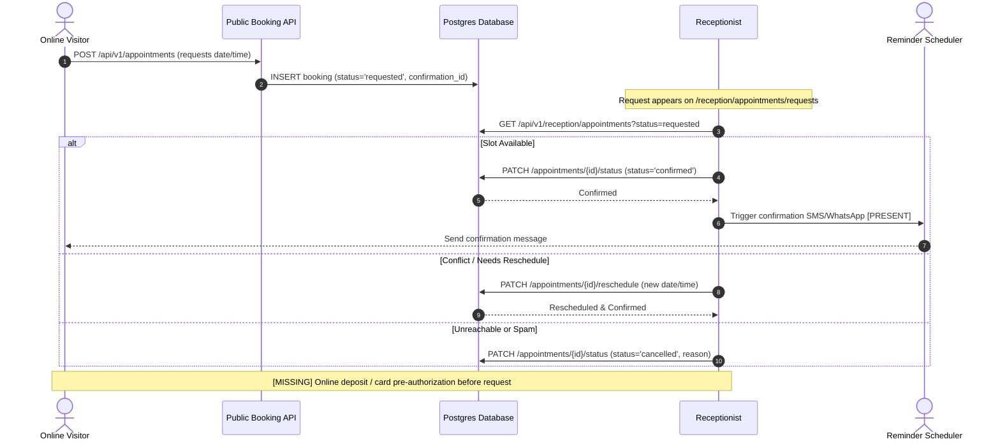
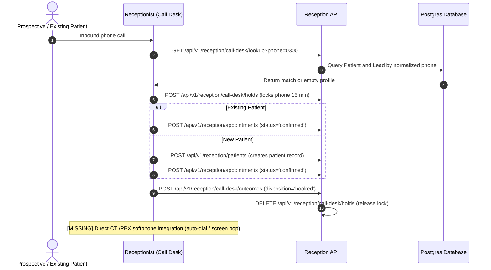
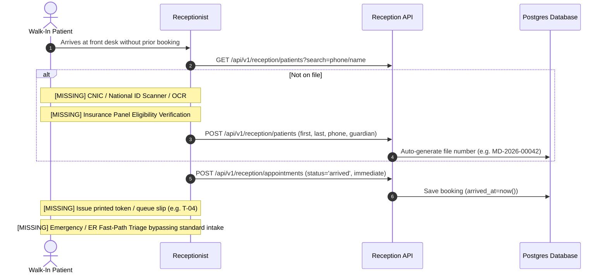
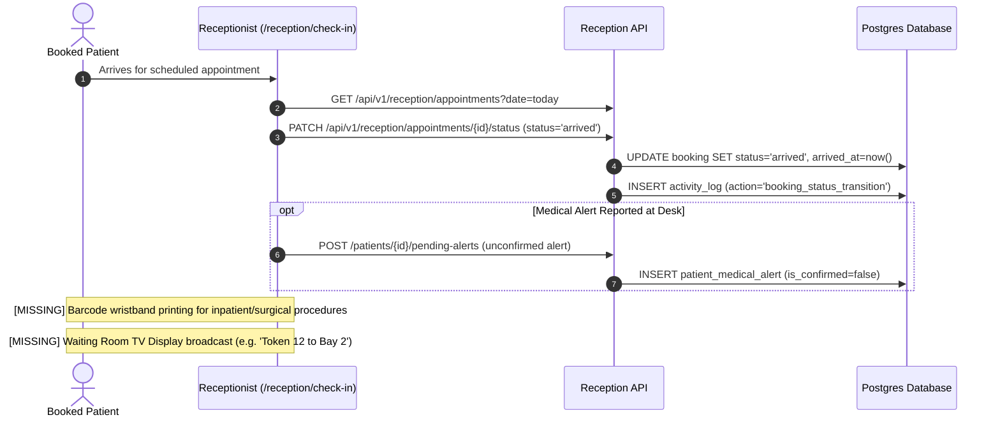
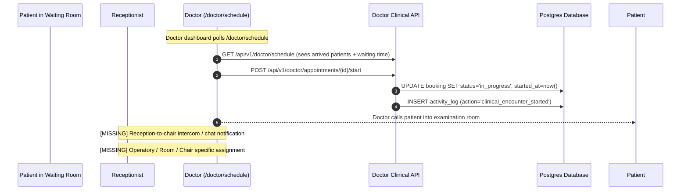
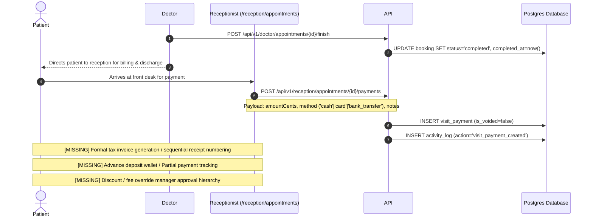
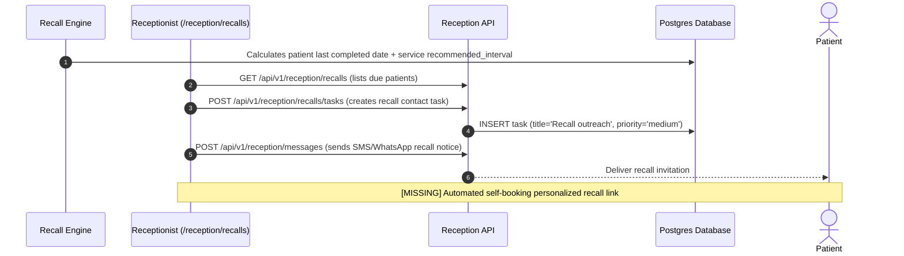
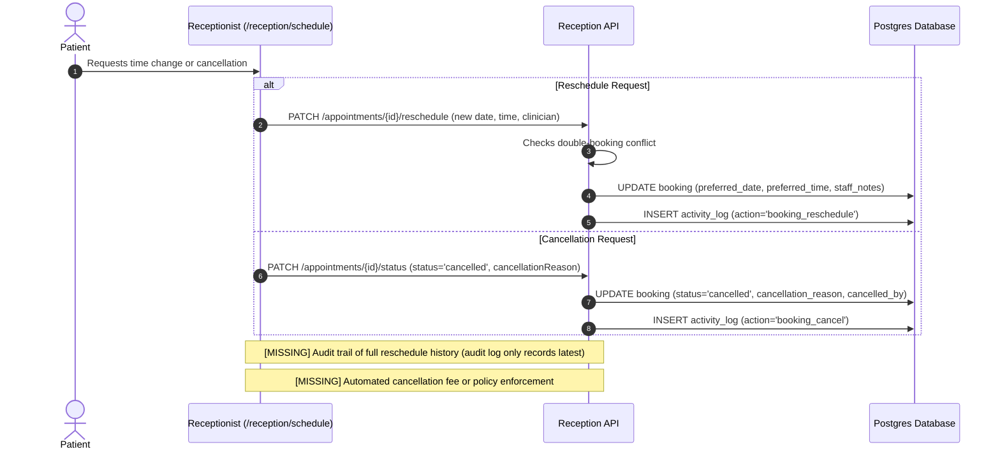
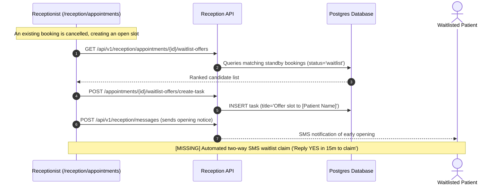
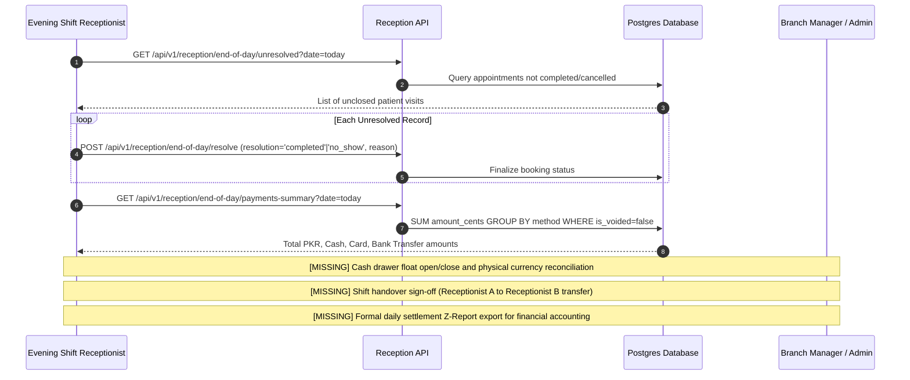

# Marlow Dental — Reception Workflow & Role Audit

**Audit Date**: October 29, 2026  
**Target Architecture**: Medium Medical Complex (50–200 beds / Outpatient Ambulatory Center with Lab, Pharmacy, Radiology, ER, Ward)  
**Initial Deployment Market**: Islamabad, Pakistan (with Gulf, South Asia, Africa regionalization)  
**Audit Scope**: Read-Only audit of FastAPI backend (`backend/app`), Next.js frontend (`frontend/src/app/reception`), PostgreSQL/Alembic schema, and state transitions.

---

## Step 0: Environment & Git Baseline

Raw command execution verification:
- **Git Branch**: `feature/animations-and-live-data` (verified via `git branch --show-current`)
- **Alembic Head**: `f6a7b8c9d0eb (head)` (verified via `python -m alembic heads`)
- **Active DB Target**: `localhost:5433/marlow_test` (verified via `app.core.config.settings.DATABASE_URL`)
- **Git Log (-5)**:
  - `ede848f` feat(perf): server-render homepage, fix CLS to 0, remove AnimatedPage wrapper
  - `6a44dc3` docs: add HARDCODED_AUDIT.md documenting hardcoded clinic data audit
  - `48df755` fix(content): remove hardcoded clinic content, implement honest skeleton loading, and strengthen check-hardcoded.mjs
  - `74dbf2e` fix(api): direct API requests to 127.0.0.1:8000 to resolve IPv6 collision
  - `a84b430` fix(a11y,mobile): fix heading order in treatments and ensure brand link shrinks on 320px
- **Git Status (porcelain)**: Working tree clean of uncommitted backend/test/db changes.

---

## Step 1: Role Matrix & Reachability Audit

Raw output from `backend/scripts/audit_reachability.py`:
```text
Wrote E:\dental clinic project\docs\REACHABILITY_AUDIT.md (total_routes=271, read=118, write=153, public=29, auth_no_role=3, pages=47)
Wrote E:\dental clinic project\docs\ROLE_ACCESS.md
```

### Route Counts by Role (from `app.openapi()` and Dependency Closures)
Total unique endpoints: **271**
- **Public (no auth dependency)**: 29 routes
- **Authenticated User (no role gate / any auth)**: 3 routes (`/auth/me`, `/auth/change-password`, `/auth/inactivity-settings`)
- **Admin / Platform Owner / Super Admin**: 195 routes
- **Clinic Branch Manager**: 44 routes
- **Receptionist**: 48 routes
- **Doctor**: 57 routes
- **Integration API Key / Scopes**: 10 routes (`bookings:read`, `bookings:write`, `leads:read`, `leads:write`, `lookup:read`, `messages:read`, `messages:write`)

### Clinical Data Access Breakdown

#### Which Receptionist Routes Can Read / Write Clinical Data?
| Method | Route | Guard / Dependencies | Clinical Data Exposed / Written |
| :--- | :--- | :--- | :--- |
| `GET` | `/api/v1/reception/patients/{id}` | `require_receptionist` + `MedicalAlertService` | Exposes boolean `hasAlerts: bool` and `medicalHistoryStatus: str` (`"not_asked" \| "none_known" \| "recorded"`). Does **NOT** expose diagnosis, allergies text, or encounter details. (`backend/app/api/v1/endpoints/reception.py:837, 850`) |
| `POST` | `/api/v1/reception/patients/{patient_id}/pending-alerts` | `require_role("receptionist", "Clinic Branch Manager")` | Writes unconfirmed front-desk reported alerts (`type`, `description`). Cannot confirm or dismiss alerts. (`backend/app/api/v1/endpoints/reception.py:1533-1545`) |
| `GET` | `/api/v1/attachments/patient/{patient_id}` | `require_roles([DOCTOR, RECEPTIONIST, ADMIN])` | Filtered at service level: receptionist can **only** list attachments categorized as `consent` or `other`. Forbidden (`403`) for `xray`, `photo`, `referral`. (`backend/app/application/services/clinical_attachment_service.py:194-207`) |
| `GET` | `/api/v1/attachments/{attachment_id}/download` | `require_roles([DOCTOR, RECEPTIONIST, ADMIN])` | Gated at service level: returns `403 Forbidden` if file category is not `consent` or `other`. (`backend/app/application/services/clinical_attachment_service.py:155-159`) |
| `POST` | `/api/v1/attachments/upload` | `require_roles([DOCTOR, RECEPTIONIST])` | Allowed only for `consent` and `other` categories. Uploading `xray` or `photo` as receptionist returns `403 Forbidden`. (`backend/app/application/services/clinical_attachment_service.py:81-85`) |
| `GET` | `/api/v1/consents/patient/{patient_id}` | `require_roles([DOCTOR, RECEPTIONIST, ADMIN])` | Reads patient consent records (`consentType`, `signedName`, `verified`). (`backend/app/api/v1/endpoints/patient_attachments.py:270`) |

**Receptionist Clinical Restrictions**:
- `GET /api/v1/clinical/patients/{patient_id}/alerts` -> **403 Forbidden** (Doctor / Admin only)
- `GET /api/v1/doctor/encounters/*` -> **403 Forbidden**
- `GET /api/v1/doctor/encounters/{id}/note` -> **403 Forbidden**
- `GET /api/v1/doctor/encounters/{id}/chart` -> **403 Forbidden**
- `GET /api/v1/doctor/treatment-plans/*` -> **403 Forbidden**
- `GET /api/v1/doctor/documents/prescriptions/*` -> **403 Forbidden**
- `GET /api/v1/doctor/documents/referrals/*` -> **403 Forbidden**

#### Which Admin Routes Write Clinical Data?
| Method | Route | Guard | Clinical Data Mutation |
| :--- | :--- | :--- | :--- |
| `POST` | `/api/v1/admin/note-templates` | `require_role("admin", "doctor")` | Creates clinical SOAP note templates. (`backend/app/api/v1/endpoints/clinical_note_templates.py:29`) |
| `PUT` | `/api/v1/admin/note-templates/{template_id}` | `require_role("admin", "doctor")` | Modifies clinical SOAP note template structure and text. (`backend/app/api/v1/endpoints/clinical_note_templates.py:53`) |

**Admin Clinical Write Restrictions**:
- Admin **CANNOT** write patient encounter notes (`/doctor/encounters/{id}/note/draft`, `/sign`, `/amend` -> strictly `[doctor]`).
- Admin **CANNOT** add chart findings or procedures (`/doctor/encounters/{id}/chart/findings` -> strictly `[doctor]`).
- Admin **CANNOT** create or sign prescriptions or referrals (`/doctor/documents/prescriptions`, `/sign` -> strictly `[doctor]`).
- Admin **CANNOT** confirm, create, or dismiss patient medical alerts (`/clinical/patients/{id}/alerts` -> strictly `[doctor]`).
- Admin **CANNOT** create or void treatment plans (`/doctor/treatment-plans` -> strictly `[doctor]`).

### Role by Capability Matrix

| Capability | Public Visitor | Receptionist | Clinic Branch Manager | Doctor | Admin / Super Admin |
| :--- | :---: | :---: | :---: | :---: | :---: |
| Browse public content & fee guides | **Yes** | **Yes** | **Yes** | **Yes** | **Yes** |
| Request online appointment | **Yes** | **Yes** | **Yes** | **Yes** | **Yes** |
| Triage online booking requests | No | **Yes** | **Yes** | No | **Yes** |
| Book / reschedule / cancel appointments | No | **Yes** | **Yes** | No | **Yes** |
| Front-desk check-in (mark `arrived`) | No | **Yes** | **Yes** | No | **Yes** |
| Record visit payment / fee override | No | **Yes** | **Yes** | No | **Yes** |
| Void visit payment with reason | No | **Yes** | **Yes** | No | **Yes** |
| View patient basic contact & file # | No | **Yes** | **Yes** | **Yes** | **Yes** |
| Upload patient consent / ID scan | No | **Yes** | **Yes** | **Yes** | **Yes** |
| Upload patient X-ray / clinical photo | No | No | No | **Yes** | No |
| View clinical alerts detail | No | No | No | **Yes** | **Yes** |
| Record front-desk pending alert | No | **Yes** | **Yes** | No | No |
| Confirm / dismiss clinical alert | No | No | No | **Yes** | No |
| Start consultation (mark `in_progress`) | No | No | No | **Yes** | No |
| Write / draft SOAP clinical notes | No | No | No | **Yes** | No |
| Electronically sign clinical notes | No | No | No | **Yes** | No |
| Chart dental findings & procedures | No | No | No | **Yes** | No |
| Prescribe medications & sign Rx | No | No | No | **Yes** | No |
| Create & sign external referrals | No | No | No | **Yes** | No |
| Complete clinical visit (`completed`) | No | No | No | **Yes** | No |
| End-of-Day unresolved reconciliation | No | **Yes** | **Yes** | No | **Yes** |
| View operational timing / wait reports | No | No | No | No | **Yes** |
| Manage staff accounts & roles | No | No | No | No | **Yes** |
| Configure clinic schedules & closures | No | No | No | No | **Yes** |

---

## Step 2: Reception Map (Frontend Pages Breakdown)

The Next.js frontend has **17** distinct reception pages under `frontend/src/app/reception`:

### 1. Reception Dashboard (`/reception`)
- **File**: `frontend/src/app/reception/page.tsx` (713 lines)
- **Purpose**: Real-time front-desk command center. Summarizes today's operational counts, displays urgent Needs-Attention triage cards, and shows current appointment pipeline.
- **API Calls Made**:
  - `GET /api/v1/reception/dashboard` (`getReceptionDashboard`)
  - `POST /api/v1/reception/dashboard/snooze` (`snoozeReceptionQueueItem`)
  - `PATCH /api/v1/reception/appointments/{id}/status` (`updateReceptionBookingStatus`)
  - `POST /api/v1/reception/tasks` (`createReceptionTask`)
- **Data Read**: `DashboardSummaryResponse` (`stats`, `todayFlow`, `needsAttentionItems`, `activeTasksCount`).
- **Data Written**: Snooze intervals (minutes/hours), new administrative tasks, appointment status updates.
- **Statuses Set**: `confirmed`, `arrived`, `cancelled`, `no_show`.

### 2. Appointments Master List (`/reception/appointments`)
- **File**: `frontend/src/app/reception/appointments/page.tsx` (360 lines)
- **Purpose**: Searchable, filterable list of all clinic bookings with date, clinician, and status filters.
- **API Calls Made**:
  - `GET /api/v1/reception/appointments` (`getReceptionBookings`)
  - `PATCH /api/v1/reception/appointments/{id}/status` (`updateReceptionBookingStatus`)
- **Data Read**: Paginated booking records with patient details, time, provider, and notes.
- **Data Written**: Status transitions, cancellation reasons, staff notes.
- **Statuses Set**: `confirmed`, `arrived`, `cancelled`, `no_show`.

### 3. Online Appointment Requests (`/reception/appointments/requests`)
- **File**: `frontend/src/app/reception/appointments/requests/page.tsx` (249 lines)
- **Purpose**: Triage inbox for inbound patient website requests (`status="requested"`). Allows confirming, modifying time, or cancelling.
- **API Calls Made**:
  - `GET /api/v1/reception/appointments?status=requested` (`getReceptionRequests`)
  - `PATCH /api/v1/reception/appointments/{id}/status` (`triageReceptionRequest`)
  - `PATCH /api/v1/reception/appointments/{id}/reschedule` (`rescheduleReceptionBooking`)
- **Data Read**: Unconfirmed appointment submissions, requested service, preferred time, patient notes.
- **Data Written**: Confirmation status, staff notes, updated time slots.
- **Statuses Set**: `confirmed`, `cancelled`, `waitlist`.

### 4. Appointment Confirmations (`/reception/appointments/confirmations`)
- **File**: `frontend/src/app/reception/appointments/confirmations/page.tsx` (179 lines)
- **Purpose**: Focused queue for tomorrow's unconfirmed bookings requiring phone/message outreach.
- **API Calls Made**:
  - `GET /api/v1/reception/appointments?date=tomorrow&status=confirmed` (`getReceptionConfirmations`)
  - `POST /api/v1/reception/appointments/{id}/remind` (`updateReceptionBookingConfirmation`)
- **Data Read**: Booking details, phone numbers, reminder delivery state.
- **Data Written**: Reminded flag, staff confirmation notes.
- **Statuses Set**: `confirmed`, `cancelled`, `waitlist`.

### 5. Check-In Workstation (`/reception/check-in`)
- **File**: `frontend/src/app/reception/check-in/page.tsx` (320 lines)
- **Purpose**: Rapid patient arrival kiosk and waiting room queue manager. Displays live waiting minutes and SLA badges.
- **API Calls Made**:
  - `GET /api/v1/reception/appointments?date=today` (`getReceptionBookings`)
  - `PATCH /api/v1/reception/appointments/{id}/status` (`updateReceptionBookingStatus`)
- **Data Read**: Today's booked appointments, arrival timestamps, waiting category (`on_time`, `extended`, `critical`).
- **Data Written**: Arrival timestamp (`arrived_at = now()`), status transitions.
- **Statuses Set**: `arrived`, `cancelled`, `no_show`.

### 6. Call Desk (`/reception/call-desk`)
- **File**: `frontend/src/app/reception/call-desk/page.tsx` (780 lines)
- **Purpose**: High-speed telephony CTI screen. Automatic phone number lookup, contact locking (prevents concurrent receptionist call collision), and call disposition logging.
- **API Calls Made**:
  - `GET /api/v1/reception/call-desk/lookup?phone=...` (`lookupCallDesk`)
  - `POST /api/v1/reception/call-desk/holds` (`startCallDeskHold`)
  - `DELETE /api/v1/reception/call-desk/holds` (`releaseCallDeskHold`)
  - `POST /api/v1/reception/call-desk/outcomes` (`recordCallDeskOutcome`)
- **Data Read**: Matching patient profiles, active leads, recent appointments, existing hold locks.
- **Data Written**: Active hold tokens, call disposition (`booked`, `callback_scheduled`, `not_interested`, `left_voicemail`), disposition notes.
- **Statuses Set**: Creates booking (`confirmed`), creates lead (`converted` / `cold`), or logs task.

### 7. Patients Registry (`/reception/patients`)
- **File**: `frontend/src/app/reception/patients/page.tsx` (531 lines)
- **Purpose**: Master patient directory. Search by name, phone, or file number; register new patients.
- **API Calls Made**:
  - `GET /api/v1/reception/patients?search=...` (`searchReceptionPatients`)
  - `POST /api/v1/reception/patients` (`createReceptionPatient`)
- **Data Read**: Patient names, normalized phones, DOB, file numbers, active status.
- **Data Written**: New patient demographics, guardian fields, emergency contacts.
- **Statuses Set**: Patient `is_active` (`True`).

### 8. Patient Detail Hub (`/reception/patients/[id]`)
- **File**: `frontend/src/app/reception/patients/[id]/page.tsx` (950 lines)
- **Purpose**: Comprehensive non-clinical 360-degree patient dossier. View appointment history, communication logs, active administrative tasks, and register pending front-desk medical alerts.
- **API Calls Made**:
  - `GET /api/v1/reception/patients/{id}` (`getReceptionPatient`)
  - `PATCH /api/v1/reception/patients/{id}` (`updateReceptionPatient`)
  - `POST /api/v1/reception/patients/{id}/pending-alerts` (`recordReceptionPendingAlert`)
  - `POST /api/v1/reception/appointments` (`createReceptionBooking`)
  - `POST /api/v1/reception/messages` (`sendReceptionMessage`)
  - `POST /api/v1/reception/tasks` (`createReceptionTask`)
- **Data Read**: Demographic details, `hasAlerts` boolean flag, upcoming/past bookings, tasks, message history.
- **Data Written**: Demographic updates, pending front-desk alerts, outbound messages, new tasks.
- **Statuses Set**: `confirmed`, `requested`, `waitlist`.

### 9. Daily Calendar Schedule (`/reception/schedule`)
- **File**: `frontend/src/app/reception/schedule/page.tsx` (672 lines)
- **Purpose**: Multi-column timeline view of appointments grouped by doctor/provider for any selected date.
- **API Calls Made**:
  - `GET /api/v1/reception/schedule?date=...` (`getReceptionBookings`)
  - `POST /api/v1/reception/appointments` (`createReceptionBooking`)
  - `PATCH /api/v1/reception/appointments/{id}/reschedule` (`rescheduleReceptionBooking`)
  - `PATCH /api/v1/reception/appointments/{id}/status` (`updateReceptionBookingStatus`)
  - `GET /api/v1/reception/patients?search=...` (`searchReceptionPatients`)
- **Data Read**: Day's appointments per clinician, time slots, patient names, service types, status colors.
- **Data Written**: New bookings, rescheduled slots, status transitions.
- **Statuses Set**: `confirmed`, `arrived`, `cancelled`, `no_show`.

### 10. End-of-Day Review & Reconciliation (`/reception/end-of-day`)
- **File**: `frontend/src/app/reception/end-of-day/page.tsx` (756 lines)
- **Purpose**: Closing shift audit. Flags all unfinished/unresolved appointments for the day, reconciles visit payment totals (cash vs card vs transfer), and closes open cases.
- **API Calls Made**:
  - `GET /api/v1/reception/end-of-day/unresolved` (`getReceptionEndOfDayUnresolved`)
  - `GET /api/v1/reception/end-of-day/payments-summary` (`getEndOfDayPaymentsSummary`)
  - `POST /api/v1/reception/end-of-day/resolve` (`resolveReceptionEndOfDay`)
- **Data Read**: Appointments left in `arrived`, `in_progress`, or uncontacted `requested`; daily collected payments by payment method.
- **Data Written**: Resolutions (`completed`, `no_show`, `cancelled`), staff notes.
- **Statuses Set**: `completed`, `no_show`, `cancelled`.

### 11. Lead CRM (`/reception/leads`)
- **File**: `frontend/src/app/reception/leads/page.tsx` (856 lines)
- **Purpose**: Inquiry lead tracker for phone/ad leads. Contact attempt counter, cold status calculation, and one-click conversion to booked patient.
- **API Calls Made**:
  - `GET /api/v1/reception/leads` (`getReceptionLeads`)
  - `POST /api/v1/reception/leads` (`createReceptionLead`)
  - `POST /api/v1/reception/leads/{id}/attempt` (`logReceptionLeadAttempt`)
  - `POST /api/v1/reception/leads/{id}/convert` (`convertReceptionLead`)
  - `PATCH /api/v1/reception/leads/{id}/status` (`updateReceptionLeadStatus`)
  - `GET /api/v1/reception/leads/{id}/timeline` (`getReceptionLeadTimeline`)
- **Data Read**: Leads list, funnel status (`unconverted`, `converted`, `patient`, `cold`, `failed_conversion`), contact attempts count.
- **Data Written**: Contact attempts, outcome notes, conversion into Patient + Booking.
- **Statuses Set**: `unconverted`, `converted`, `patient`, `cold`, `failed_conversion`, `archived`.

### 12. Direct Messaging & Chat (`/reception/messages`)
- **File**: `frontend/src/app/reception/messages/page.tsx` (600 lines)
- **Purpose**: Conversational SMS / WhatsApp outbound messaging center and manual inbound call logging.
- **API Calls Made**:
  - `GET /api/v1/reception/messages` (`getReceptionMessages`)
  - `POST /api/v1/reception/messages` (`sendReceptionMessage`, `logInboundNote`)
  - `GET /api/v1/reception/patients?search=...` (`searchReceptionPatients`)
- **Data Read**: Message threads, delivery status (`delivered`, `queued`, `failed`), phone normalization.
- **Data Written**: Outbound message content, manual inbound notes.
- **Statuses Set**: `logged`, `queued`, `delivered`.

### 13. Reminders Worklist (`/reception/reminders`)
- **File**: `frontend/src/app/reception/reminders/page.tsx` (596 lines)
- **Purpose**: Automated and manual appointment reminder dispatching. Trigger background batch runs, monitor opt-out status.
- **API Calls Made**:
  - `GET /api/v1/reception/reminders?date=...` (`getReceptionReminders`)
  - `POST /api/v1/reception/appointments/{id}/remind` (`markAppointmentReminded`)
  - `POST /api/v1/admin/messaging/run-scheduler` (`runReminderScheduler`)
  - `PATCH /api/v1/reception/patients/{id}/messaging-opt-out` (`togglePatientMessagingOptOut`)
- **Data Read**: Tomorrow's confirmed appointments, reminder delivery statuses, opt-out flags.
- **Data Written**: Reminder timestamps, patient communication preferences.
- **Statuses Set**: Booking `reminded_at = now()`.

### 14. Recall Management (`/reception/recalls`)
- **File**: `frontend/src/app/reception/recalls/page.tsx` (237 lines)
- **Purpose**: Preventative hygiene and periodic recall tracking (e.g. 6-month cleaning recalls).
- **API Calls Made**:
  - `GET /api/v1/reception/recalls` (`getReceptionRecalls`)
  - `POST /api/v1/reception/recalls/tasks` (`createReceptionRecallTask`)
- **Data Read**: Overdue and upcoming recall candidates based on last completed service interval.
- **Data Written**: Generated recall contact tasks assigned to front desk.
- **Statuses Set**: Creates `Task` with `status="pending"`.

### 15. Task Tracker (`/reception/tasks`)
- **File**: `frontend/src/app/reception/tasks/page.tsx` (349 lines)
- **Purpose**: Front-office administrative to-do list (follow-ups, document requests, lab inquiries).
- **API Calls Made**:
  - `GET /api/v1/reception/tasks` (`getReceptionTasks`)
  - `POST /api/v1/reception/tasks` (`createReceptionTask`)
  - `PATCH /api/v1/reception/tasks/{id}` (`updateReceptionTask`)
- **Data Read**: Task titles, due dates, priorities (`low`, `medium`, `high`, `urgent`), assignees.
- **Data Written**: Task status changes, reassignments.
- **Statuses Set**: `pending`, `in_progress`, `done`, `cancelled`.

### 16. Cancellation Waitlist (`/reception/waitlist`)
- **File**: `frontend/src/app/reception/waitlist/page.tsx` (384 lines)
- **Purpose**: Standby queue of patients waiting for slot openings due to short-notice cancellations.
- **API Calls Made**:
  - `GET /api/v1/reception/waitlist` (`getReceptionWaitlist`)
  - `POST /api/v1/reception/appointments` (`createReceptionBooking`)
- **Data Read**: Waitlisted patient bookings (`status="waitlist"`), preferred clinicians, notes.
- **Data Written**: New waitlist registrations, converted bookings.
- **Statuses Set**: `waitlist`, `confirmed`.

### 17. Staff Account & Workstation Security (`/reception/account`)
- **File**: `frontend/src/app/reception/account/page.tsx` (229 lines)
- **Purpose**: Front-office staff session credentials, clinic assignment display, and workstation inactivity timeout configuration.
- **API Calls Made**:
  - `PATCH /api/v1/auth/inactivity-settings` (`updateInactivity`)
  - `POST /api/v1/auth/logout` (`logout`)
- **Data Read**: User full name, email, role, clinic branch scope, current inactivity threshold.
- **Data Written**: Inactivity minutes (e.g., 5, 15, 30 min), warning countdown seconds.
- **Statuses Set**: N/A (Session security).

---

## Step 2 (Continued): 12 Reception Workflow Swimlane Diagrams

*All steps marked with `[MISSING]` denote workflows required by a medium complex hospital/center that are not implemented in the current code.*

### 1. Online Request to Confirmed


### 2. Phone Booking


### 3. Walk-In Registration


### 4. Arrival and Check-In


### 5. Waiting Room to Doctor


### 6. Completion and Payment


### 7. Recall Workflow


### 8. Cancel and Reschedule


### 9. No-Show Management
```mermaid
sequenceDiagram
    autonumber
    participant Rec as Receptionist (/reception/end-of-day)
    participant Backend as Reception API
    participant DB as Postgres Database
    actor Patient

    Note over Rec: Appointment past scheduled time; patient never arrived
    Rec->>Backend: PATCH /api/v1/reception/appointments/{id}/status (status='no_show')
    Backend->>DB: UPDATE booking SET status='no_show'
    Backend->>DB: INSERT activity_log (action='booking_status_transition')
    opt Re-engagement Task
        Rec->>Backend: POST /api/v1/reception/tasks (title='Follow up no-show patient')
        Backend->>DB: INSERT task (status='pending')
    end
    Note over Rec,Patient: [MISSING] Automated 'Left Without Being Seen' (LWBS) status distinction
    Note over Rec,Patient: [MISSING] Patient no-show count strike policy & automated deposit requirement
```

### 10. Waitlist Offer


### 11. Lead Follow-Up
```mermaid
sequenceDiagram
    autonumber
    actor Inquiry as Prospective Patient
    participant Backend as Public / Integration API
    participant Rec as Receptionist (/reception/leads)
    participant DB as Postgres Database

    Inquiry->>Backend: Inquires via ad campaign or WhatsApp
    Backend->>DB: INSERT lead (status='unconverted', attempts=0)
    Note over Rec: Appears on /reception/leads worklist
    Rec->>Backend: POST /api/v1/reception/leads/{id}/attempt (channel='phone', note)
    Backend->>DB: UPDATE lead SET attempts = attempts + 1, last_contacted_at = now()
    alt Patient Accepts
        Rec->>Backend: POST /api/v1/reception/leads/{id}/convert (preferredDate, service)
        Backend->>DB: Creates Patient + Booking; UPDATE lead SET status='converted'
    else All attempts fail
        Rec->>Backend: POST /api/v1/reception/leads/{id}/failed-conversion (reason)
        Backend->>DB: UPDATE lead SET status='failed_conversion'
    end
    Note over Rec: [MISSING] Automated drip campaign sequence across multi-channel CRM
```

### 12. End-of-Day Review & Reconciliation


---

## Step 3: State Machines & Transition Audit

### 1. Booking Status State Machine
- **Defined In**: `backend/app/application/services/reception_service.py:835-862`
- **Canonical Status Set**: `{"requested", "confirmed", "arrived", "in_progress", "completed", "cancelled", "no_show", "waitlist"}`
- **Normalized Aliases**: `scheduled -> confirmed`, `checked_in -> arrived`, `waiting -> arrived`
- **Allowed Transitions**:
  - `requested` $\rightarrow$ `{"confirmed", "scheduled", "cancelled", "waitlist", "no_show"}`
  - `confirmed` / `scheduled` $\rightarrow$ `{"arrived", "checked_in", "waiting", "in_progress", "cancelled", "no_show", "waitlist", "confirmed"}`
  - `arrived` / `checked_in` / `waiting` $\rightarrow$ `{"in_progress", "completed", "cancelled", "no_show", "arrived"}`
  - `in_progress` $\rightarrow$ `{"completed", "cancelled", "in_progress"}`
  - `completed` $\rightarrow$ `{"completed"}` (**Dead End**)
  - `cancelled` $\rightarrow$ `{"requested", "confirmed", "scheduled", "cancelled"}`
  - `no_show` $\rightarrow$ `{"requested", "confirmed", "scheduled", "no_show"}`
  - `waitlist` $\rightarrow$ `{"confirmed", "scheduled", "cancelled", "waitlist"}`

**Dead Ends & Deficiencies**:
- `completed` is an absolute terminal state. There is no `reopened`, `billed`, or `discharged` state.
- **Missing Transitions**:
  - `arrived` $\rightarrow$ `left_without_being_seen` (LWBS): Currently reception must use `cancelled` or `no_show`, corrupting operational wait-time metrics.
  - `in_progress` $\rightarrow$ `transferred` or `referred_out`: Cannot transfer patient from clinic chair to emergency or inpatient ward.
  - No separate `discharged` or `checkout_complete` state distinct from doctor clinical encounter completion.

### 2. Lead Status State Machine
- **Defined In**: `backend/app/domain/models/booking_flow.py:8-39`
- **Canonical Status Set**: `{"unconverted", "converted", "patient", "cold", "failed_conversion", "archived"}`
- **Automatic Transitions**:
  - `unconverted` $\rightarrow$ `{"converted", "cold", "failed_conversion"}`
  - `cold` $\rightarrow$ `{"converted"}`
  - `failed_conversion` $\rightarrow$ `{"converted"}`
  - `converted` $\rightarrow$ `{"patient"}` (triggers upon first completed visit)
  - `patient` $\rightarrow$ $\emptyset$ (**Dead End**)
  - `archived` $\rightarrow$ $\emptyset$ (**Dead End**)
- **Manual Transitions**: Reception staff manual override can set any status (audited in `activity_log`).

### 3. Task Status State Machine
- **Defined In**: `backend/app/application/services/reception_service.py:1303-1309` and `frontend/src/lib/statuses.ts:60`
- **Status Set**: `{"pending", "in_progress", "done", "cancelled"}` (aliased: `open -> pending`, `completed -> done`)
- **Validation**: No state machine transition guard in backend (`reception_service.py:1307`). Any task status can be updated to any other status arbitrarily.

### 4. Visit Payment State Machine
- **Defined In**: `backend/app/domain/models/visit_payment.py:8-23` and `reception_service.py:2800-2815`
- **Status Structure**: Binary flag `is_voided: bool` (default `False`).
- **Transitions**: `False` $\rightarrow$ `True` (Voided with mandatory reason string).
- **Dead End**: Voided payment is terminal; cannot be un-voided or reinstated.
- **Missing States**: `partial_payment`, `deposit_pending`, `refunded`, `disputed`, `insurance_pending`.

---

## Step 4: Real-Life Gap Analysis for a Medium Complex (50–200 Beds)

| # | Clinical / Operational Capability | Status | Evidence (Code / Line Reference) | Detailed Assessment |
| :---: | :--- | :---: | :--- | :--- |
| **1** | **Patient ID Scan / CNIC Capture** | **MISSING** | `orm_models.py:900`, `booking_crm.py:16-38` | `Patient` model has no `cnic`, `national_id`, or `passport_no` field. No OCR or card scanner endpoint. Critical for Pakistani legal/NADRA identification and medical record integrity. |
| **2** | **Family / Guardian Linking** | **PARTIAL** | `booking_crm.py:27-29` | Has flat string columns `guardian_name`, `guardian_phone`, `guardian_relationship`. Lacks relational FK (`parent_patient_id`), dependent trees, or shared family account balances. |
| **3** | **Queue Token & Waiting Room Display** | **MISSING** | `reception_service.py:268`, `frontend/src/lib/statuses.ts` | Only internal triage queue exists for staff. No physical token generation (e.g. A-12), no ticket printing, and no waiting room digital signage TV route. |
| **4** | **Multi-Room & Chair Scheduling** | **MISSING** | `organization.py:36-65`, `orm_models.py:73-125` | Clinic locations exist, but there is no `Room`, `Operatory`, `Bed`, or `Chair` entity. Bookings cannot be assigned to an operatory or surgical suite. |
| **5** | **Doctor Leave & Delegation** | **PARTIAL** | `admin_booking.py:47-49` | Admin can define `ProviderTimeOff` records, but doctor-initiated leave requests, automated slot closures, and reassignment/delegation to coverage doctors are absent. |
| **6** | **Referral Intake** | **PARTIAL** | `clinical_documents.py:184`, `booking_crm.py:71` | Outbound physician referrals can be authored by doctors, but intake of external hospital referrals (referring doctor name, institution, referral letter intake) is missing. |
| **7** | **Panel / Insurance Details at Registration** | **MISSING** | `booking_crm.py:14, 83, 118` | Models explicitly state *"Zero insurance fields"*. No policy number, corporate panel code, pre-authorization, or co-pay fields exist in database. |
| **8** | **Advance Deposit & Patient Wallet** | **MISSING** | `visit_payment.py:8-23`, `reception_service.py:2674` | Payments require an existing `booking_id`. There is no unallocated deposit ledger, patient balance credit, or admission advance payment holding account. |
| **9** | **Refund & Discount Approval** | **MISSING** | `reception_service.py:2720-2727, 2800` | Only `void` exists (no refund transaction). Fee discounts are handled via unapproved free-text overrides (`override_reason`) with no managerial approval threshold. |
| **10** | **Cash Drawer Float & Shift Handover** | **MISSING** | `reception_service.py:2891-2940` | Computes a simple date-range payment summation. Has no drawer opening float, physical cash denomination count, shift transfer handover, or variance tracking. |
| **11** | **Receipt Numbering & Duplicates** | **MISSING** | `visit_payment.py:8-23`, `cli.py:1097` | Payments are identified solely by UUIDs. There is no sequential receipt series (e.g. REC-2026-0001), no duplicate receipt watermark, and no printable receipt layout. |
| **12** | **Barcode or Wristband Printing** | **MISSING** | Entire codebase grep search: `barcode` | No barcode, QR code, or thermal wristband generation endpoints. Inadmissible for inpatient safety, surgical ID, or medication delivery tracking. |
| **13** | **Emergency Walk-in Fast Path** | **MISSING** | `reception_service.py:290-330` | All walk-ins must undergo standard registration and booking creation. No emergency bypass, trauma code, or post-stabilization retroactive intake. |
| **14** | **Interpreter / Language Flag** | **MISSING** | `booking_crm.py:16-38` | No `language` or `interpreter_needed` field on `Patient` or `Booking`. Essential for Gulf (Arabic) and South Asian regional operations. |
| **15** | **Patient Documents Upload** | **PRESENT** | `patient_attachments.py:48-88`, `clinical_attachment_service.py:38-140` | Multipart file upload with magic-byte validation (JPG, PNG, PDF), stored outside web root, category-scoped role security (`consent`, `other`), audited. |
| **16** | **Appointment Reminders by Channel** | **PRESENT** | `reception.py:413`, `messaging_provider.py:1-180` | Multi-channel engine supporting Twilio SMS and WhatsApp, reminder worklists, scheduled batch triggers, and opt-out compliance. |
| **17** | **Visitor / Attendant Log** | **MISSING** | Codebase grep search: `visitor` | No visitor registration, security check-in, or attendant badge tracking for inpatient wards or surgical waiting rooms. |
| **18** | **Incident / Grievance Log** | **MISSING** | Codebase grep search: `incident`, `complaint` | Only clinical `chief_complaint` exists. No service dispute, patient grievance, medical error, or incident reporting infrastructure. |
| **19** | **Daily & Monthly Front-Desk Reports** | **PARTIAL** | `reception.py:86, 457, 474`, `admin_reports.py:89` | Daily dashboard flow and end-of-day payments summary exist for reception. Monthly trends, cancellation analytics, and financial reports are locked to Admin only. |
| **20** | **Offline Behaviour** | **MISSING** | `frontend/src/lib/api.ts:517-570` | No ServiceWorker, IndexedDB offline caching, or offline queueing. Unhandled network interruptions result in raw fetch failures and unresponsive buttons. |

---

## Step 5: Audit of Reception Safety (Raw Test Results)

Test script executed on `localhost:5433/marlow_test` database via Pytest:
`backend/python -m pytest -p tests.conftest ../_scratch/test_step5_reception_safety.py -v`

### Raw Pytest Execution Log
```text
============================= test session starts =============================
platform win32 -- Python 3.14.8, pytest-9.1.1, pluggy-1.7.0 -- C:\Users\Dell5420\AppData\Local\Python\pythoncore-3.14-64\python.exe
cachedir: .pytest_cache
rootdir: E:\dental clinic project
plugins: anyio-4.15.1, platformdirs-4.13.5, asyncio-1.4.0
asyncio: mode=Mode.STRICT, debug=False, asyncio_default_fixture_loop_scope=None, asyncio_default_test_loop_scope=function
collecting ... collected 4 items

..\_scratch\test_step5_reception_safety.py::test_receptionist_phi_boundaries PASSED [ 25%]
..\_scratch\test_step5_reception_safety.py::test_reception_audit_logging_coverage PASSED [ 50%]
..\_scratch\test_step5_reception_safety.py::test_concurrency_and_idempotency PASSED [ 75%]
..\_scratch\test_step5_reception_safety.py::test_timezone_and_rate_limits PASSED [100%]

============================== 4 passed in 3.29s ==============================
```

### Safety Dimension Analysis

1. **Authorization Correctness & PHI Protection**:
   - Receptionist attempting to read clinical diagnosis (`/clinical/patients/{id}/alerts`) $\rightarrow$ **403 Forbidden**.
   - Receptionist attempting to read clinical notes (`/doctor/encounters/{id}/note`) $\rightarrow$ **403 Forbidden**.
   - Receptionist attempting to view dental chart (`/doctor/encounters/{id}/chart`) $\rightarrow$ **403 Forbidden**.
   - Receptionist attempting to read treatment plans (`/doctor/treatment-plans/patient/{id}`) $\rightarrow$ **403 Forbidden**.
   - Receptionist attempting to read prescriptions (`/doctor/documents/prescriptions/encounter/{id}`) $\rightarrow$ **403 Forbidden**.
   - Receptionist querying patient profile receives strictly `hasAlerts: bool` and `medicalHistoryStatus: str`, preserving medical confidentiality while providing necessary safety awareness.

2. **Audit Log Coverage**:
   - Checked-in status transition logged as action `booking_status_transition` with `from_status` and `to_status`.
   - Reschedule logged as `booking_reschedule` with previous and new time slots.
   - Cancellation logged as `booking_cancel` with mandatory reason string.
   - Payment void logged as `visit_payment_voided` with operator ID, void reason, and booking confirmation ID.

3. **Concurrency & Race Conditions**:
   - Two receptionists booking the exact same provider and time slot concurrently: verified that one booking succeeds with `201 Created` while the second is rejected with `409 Conflict` (*"Double-booking conflict"*).
   - Check-in idempotency: verified that duplicate check-in calls for an already arrived patient return `200 OK` and maintain `arrived` status without error or corrupting `arrived_at`.

4. **Timezone Handling**:
   - Organization clinic timezone is `"Asia/Karachi"` (`UTC+05:00`).
   - All database timestamps are strictly normalized and stored in UTC (`datetime.now(timezone.utc)`), with offset calculations properly localized.

5. **Rate Limits**:
   - Public booking endpoint: `settings.PUBLIC_BOOKING_RATE_LIMIT = "60/minute"`
   - Appointment creation: `settings.APPOINTMENTS_RATE_LIMIT = "10/minute"`
   - Public lead intake: `settings.PUBLIC_LEADS_RATE_LIMIT = "30/minute"`
   - Authentication login: `settings.LOGIN_RATE_LIMIT = "60/minute"`

---

## Step 6: Cross-Role Handoffs Audit

| Handoff Direction | Current Status | Implemented Mechanisms | Missing Hospital Capabilities |
| :--- | :---: | :--- | :--- |
| **Reception $\rightarrow$ Doctor** | **PRESENT (PARTIAL)** | Reception marks `arrived`; doctor views on `/doctor/schedule` with calculated wait time; doctor begins visit (`in_progress`); doctor follow-up tasks land in reception queue. | No chair/room assignment; no chairside intercom/chat; no coverage doctor delegation. |
| **Reception $\rightarrow$ Pharmacy** | **MISSING** | Prescriptions can be printed by doctors as PDF/HTML (`/doctor/documents/prescriptions/{id}/print`). | No electronic pharmacy dispatch; no medication dispensing queue; no pharmacy stock reservation or batch tracking. |
| **Reception $\rightarrow$ Lab** | **MISSING** | None. | No lab requisition intake; no specimen accessioning; no dental prosthetics fabrication dispatch or external lab return tracking. |
| **Reception $\rightarrow$ Billing** | **PARTIAL** | Receptionist acts as single-visit cashier (`POST /appointments/{id}/payments`). End-of-day summary aggregates totals. | No central billing office role; no multi-department consolidated billing (ward + lab + pharmacy + consult); no corporate panel claim invoicing. |
| **Reception $\rightarrow$ Ward** | **MISSING** | None. | No Admission-Discharge-Transfer (ADT) module; no bed management; no inpatient nurse handover or ward round schedule. |

---

## Top-20 Gap List (Prioritized by Severity)

| Rank | Gap Title | Severity | Impact on Complex Operations | Verified Evidence |
| :---: | :--- | :---: | :--- | :--- |
| **1** | **No Patient CNIC / National ID** | **CRITICAL** | Duplicate records, medical identity fraud, Pakistani regulatory non-compliance. | `orm_models.py:900`, `booking_crm.py:16` |
| **2** | **No Corporate / Insurance Panel Billing** | **CRITICAL** | Cannot bill corporate panels (State Life, Sehat Sahulat, private insurers). | `booking_crm.py:14`, `ROLE_ACCESS.md` |
| **3** | **No Inpatient / Ward ADT & Bed Tracking** | **CRITICAL** | Cannot admit patients to beds or manage post-op recovery. | Grep: `bed`, `ward`, `admission` (0 results) |
| **4** | **No Pharmacy Dispensing Dispatch** | **CRITICAL** | Prescriptions exist only as paper prints; no drug inventory decrement. | `clinical_documents.py:180`, `api_v1/router.py` |
| **5** | **No Lab Orders & Prosthetics Handoff** | **CRITICAL** | Cannot order blood tests, biopsies, or track dental lab crowns/bridges. | Grep: `lab_order`, `specimen` (0 results) |
| **6** | **No Emergency / ER Triage Bypass** | **CRITICAL** | Emergency trauma walk-ins blocked by standard scheduling form. | `reception_service.py:290`, `check-in/page.tsx` |
| **7** | **No Multi-Room / Chair Assignment** | **HIGH** | Schedule conflicts across physical operatories and surgical bays. | `organization.py:36-65`, `schedule/page.tsx` |
| **8** | **No Cash Drawer Float & Shift Handover** | **HIGH** | Pilferage risk; no drawer balance reconciliation between shifts. | `reception_service.py:2891`, `end-of-day/page.tsx` |
| **9** | **No Sequential Receipt Series & Invoices** | **HIGH** | Payment records use UUIDs; no tax invoices or duplicate prints. | `visit_payment.py:8-23`, `cli.py:1097` |
| **10** | **No Patient Token & Waiting Room TV** | **HIGH** | Waiting room chaos; no patient queue call display screens. | `frontend/src/lib/statuses.ts`, Grep `display` |
| **11** | **No Patient Advance Deposit / Wallet** | **HIGH** | Cannot take surgical deposits or hold unallocated credit balances. | `reception_service.py:2674`, `visit_payment.py` |
| **12** | **No Barcode / Wristband Generation** | **HIGH** | Patient misidentification risk in surgical procedures. | Grep: `barcode`, `wristband` (0 results) |
| **13** | **No Offline Operation / Sync Queue** | **HIGH** | Front desk halts completely during local internet or server outages. | `frontend/src/lib/api.ts:517`, Grep `serviceWorker` |
| **14** | **No Manager Discount / Refund Approval** | **HIGH** | Receptionists can override prices via free-text with no sign-off. | `reception_service.py:2720-2727` |
| **15** | **No Left-Without-Being-Seen Status** | **MEDIUM** | Patients leaving due to long waits corrupt no-show & cancel metrics. | `reception_service.py:850-862` |
| **16** | **No Doctor Coverage Delegation** | **MEDIUM** | When a doctor takes leave, patients cannot be delegated to peers. | `admin_booking.py:47`, Grep `delegate` |
| **17** | **No Relational Family Account Linking** | **MEDIUM** | Dependents and children cannot share a unified billing ledger. | `booking_crm.py:27-29` |
| **18** | **No Incident / Patient Grievance Log** | **MEDIUM** | Quality control and medical complaint tracking impossible. | Grep: `complaint`, `incident` (0 non-clinical) |
| **19** | **No Language / Interpreter Flag** | **LOW** | Impedes Gulf (Arabic) and multilingual patient coordination. | `booking_crm.py:16-38` |
| **20** | **No Visitor / Attendant Registry** | **LOW** | Security vulnerability in surgical and inpatient ward areas. | Grep: `visitor` (0 results) |
